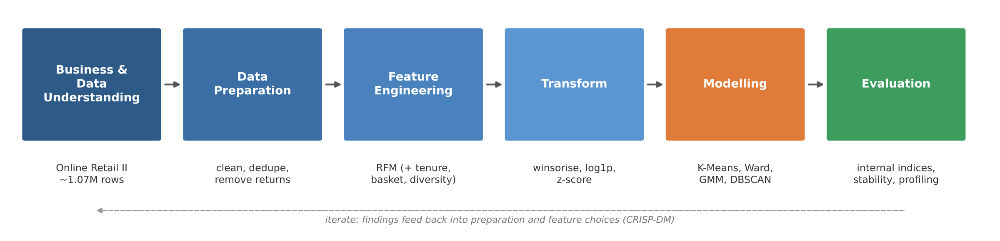
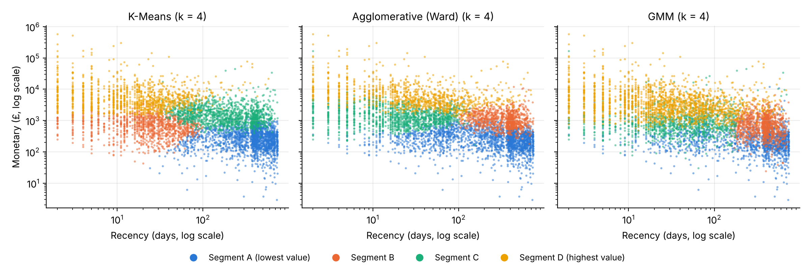
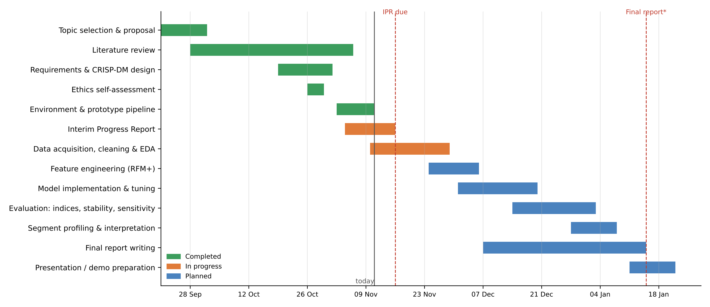

# Comparative Analysis of Data Mining Techniques for Customer Segmentation in E-commerce

MSc Computer Science project · Dileep Reddy Rupireddy · Status: **in progress (Interim Progress Report stage, November 2026)**

This project compares four families of clustering algorithms for segmenting e-commerce customers, using a multi-criteria evaluation: statistical validity, stability, scalability and business interpretability.

| Family | Algorithm |
|---|---|
| Partitional | K-Means (k-means++) |
| Hierarchical | Agglomerative clustering, Ward linkage |
| Probabilistic | Gaussian Mixture Model |
| Density-based | DBSCAN |

**Research question:** How do K-Means, Agglomerative Hierarchical (Ward), Gaussian Mixture Model and DBSCAN clustering compare in the quality, stability and business usefulness of the customer segments they produce from real e-commerce transaction data?



## Repository structure

```
├── segmentation_pipeline.py   # main pipeline: load → clean → RFM → 4 models → evaluation
├── plot_segments.py           # side-by-side segment plots + pairwise agreement (ARI)
├── make_synthetic.py          # schema-matched synthetic data for testing the code
├── requirements.txt
├── results/                   # baseline run, k = 2
├── results_k4/                # follow-up run, k = 4
├── run_log.txt, run_log_k4.txt
├── data/README.md             # how to obtain the dataset (not stored here)
└── docs/                      # Interim Progress Report and figures
```

## How to run

```bash
python3 -m venv venv
source venv/bin/activate          # Windows: venv\Scripts\activate
pip install -r requirements.txt

# download online_retail_II.xlsx first - see data/README.md
python segmentation_pipeline.py --data online_retail_II.xlsx --out results            # k chosen by Silhouette
python segmentation_pipeline.py --data online_retail_II.xlsx --out results_k4 --k 4   # fixed k
python plot_segments.py --labels results_k4/rfm_labels.csv --out results_k4
```

All random processes use a fixed seed (42), so results are reproducible.

## Pipeline

1. **Cleaning:** six documented rules, with an audit log of the rows remaining after each rule (`cleaning_audit.csv`).
2. **Features:** Recency, Frequency and Monetary (RFM) per customer.
3. **Transformation:** 99th-percentile winsorising, log(1 + x), z-score scaling.
4. **Model selection:** elbow and Silhouette for k = 2–10; k-distance plot for DBSCAN's eps.
5. **Evaluation:** Silhouette, Davies–Bouldin and Calinski–Harabasz indices, noise %, fit time, and bootstrap stability (mean Adjusted Rand Index over 20 × 80% subsamples).

## Results so far (5,861 customers)

**k = 4** (↑ higher is better, ↓ lower is better)

| Model | Silhouette ↑ | Davies–Bouldin ↓ | Calinski–Harabasz ↑ | Stability (ARI) |
|---|---|---|---|---|
| K-Means | **0.367** | **0.929** | **5,275.5** | 0.990 |
| Agglomerative (Ward) | 0.270 | 1.137 | 4,117.8 | – |
| GMM | 0.236 | 1.167 | 3,521.2 | 0.967 |
| DBSCAN (eps = 0.366) | 0.285 | 0.987 | 2,940.9 | – |

K-Means segments at k = 4 (medians):

| Segment | Share | Recency (days) | Orders | Spend (£) |
|---|---|---|---|---|
| Champions | 20.7% | 17 | 13 | 4,838 |
| Recent, low spend | 21.1% | 24 | 3 | 708 |
| At-risk, mid value | 24.7% | 185 | 4 | 1,442 |
| One-time, lapsed | 33.5% | 402 | 1 | 271 |

**Key early finding:** at k = 4 the algorithms only partly agree (pairwise ARI ≈ 0.40–0.46), so the choice of technique visibly changes which customers end up in each segment.



These are preliminary results. Planned next: extended RFM+ features, preprocessing sensitivity, scalability tests and full stability analysis (see the project plan in `docs/`).



## Ethics and data protection

The project uses only a public, pseudonymised dataset (no names or contact details). The raw data and all customer-level outputs (`rfm_labels.csv`) are deliberately excluded from this repository; only aggregated results are published. Country is not used as a clustering feature, to avoid proxy discrimination.

## Tools

Python · pandas · scikit-learn · matplotlib · Git/GitHub
